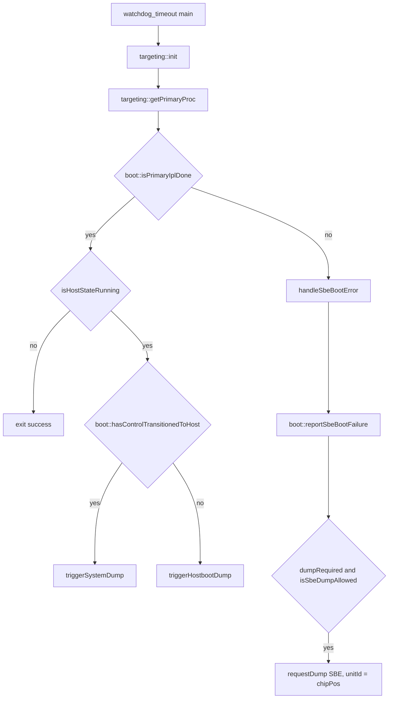

# Watchdog PHAL Abstraction – Implementation Document

Status: proposal / design (no code changed yet)
Scope: `openpower-debug-collector.1210` (P12, `phal_backend=next`) compared with
`openpower-debug-collector.1120` (P11/P10 style, pdbg + libphal, `phal_backend=legacy`).

---

## 1. Problem statement

In 1210 the `dump/` code was ported to a backend-neutral layer
(`phal/*_iface.hpp`, with `*_legacy.cpp` for pdbg/libphal and `*_next.cpp` for
hostfw targeting). The **watchdog code was not ported**. It is still the 1120
code, wrapped in `#ifdef LEGACY_PHAL`:

| File | 1210 state |
|------|-----------|
| `watchdog_timeout.cpp` | Whole file under `#ifdef LEGACY_PHAL`; only built when `phal_backend == legacy` (`meson.build`) |
| `watchdog/watchdog_main.cpp` | Whole file under `#ifdef LEGACY_PHAL` |
| `watchdog/watchdog_main.hpp` | `handleSbeBootError(struct pdbg_target*, …)` – pdbg type in a public signature |
| `watchdog/meson.build` | `watchdog_deps = [sdbusplus_dep]`, no PHAL dependency |

Consequences on a `next` (P12) build:

1. `watchdog_timeout` is **not built and not installed**. A host watchdog
   timeout on P12 produces no PEL, no dump, no host transition.
2. This is also a regression for the *non-dump* configuration: in 1120
   `watchdog_timeout` is always built and falls back to
   `report<WatchdogTimedOut>()` when `hostboot-dump-collection` is disabled. In
   1210 it is built only when `hostboot-dump-collection` is enabled **and**
   backend is `legacy`.
3. `watchdog_main.cpp`, `watchdog_dbus.cpp`, `create_pel.cpp`,
   `dump_utils.cpp`, `error_legacy.cpp` and `error_next.cpp` contain overlapping
   D-Bus/PEL/dump-request code (section 3).

Note: the request mentioned `.1110`; the sibling checkout is `.1120`, which is
what was compared.

---

## 2. What the watchdog needs from PHAL

Every backend-specific call in the watchdog flow:

| Step in `watchdog_timeout.cpp` / `watchdog_main.cpp` | Legacy API (1120) | hostfw (next) equivalent |
|---|---|---|
| init targeting | `pdbg::init()` | `TARGETING::utils::targetingInit()` – **already wrapped** as `targeting::init()` |
| get primary proc | `pdbg::getPrimaryProc()` | `TARGETING::utils::getPrimaryBootTarget(TargetPtr&)` (`target_utils.H:181`) |
| is SBE boot finished | `sbe::isPrimaryIplDone()` | `TARGETING::utils::isPrimaryIplDone()` (`target_utils.H:393`, reads SBE_MSG_REG 0x2809, Runtime state 0x6) |
| did control reach host/PHYP | `pdbg::hasControlTransitionedToHost()` | **No equivalent found in hostfw/phal** (see open item O1) |
| capture SBE FFDC | `sbe::captureFFDC(proc)` → `sbeError_t` | **No equivalent found** (see O2). hostfw produces `errl::ErrlHandle` directly from chip-ops |
| is SBE dump allowed | `sbe::isDumpAllowed(proc)` | **No equivalent found** (see O3) |
| location code for callout | `pdbg::getLocationCode()` | `TargetService::instance().getLocationCode(target)` (`hwal/targetsvc/target_service.C:83`) |
| chip position (SRC6) | `pdbg_target_index()` | `targeting::chipPos()` – **already wrapped** |
| debug path | `pdbg_target_path()` | `targeting::debugPath()` – **already wrapped** |

Already shared and backend independent: `isHostStateRunning`, `transitionHost`,
`eventWatchdogTimeout`, `triggerHostbootDump`, `triggerSystemDump`,
`requestDump`/`monitorDump`, `FFDCFile`.

---

## 3. Duplicate code inventory

| # | Concern | Copies today | Proposed single home |
|---|---------|--------------|----------------------|
| D1 | Mapper lookup `getService()` | `dump/dump_utils.cpp:119`; `watchdog/watchdog_dbus.cpp:33` (`dbusMethod`, private variant); used by `create_pel.cpp`, `error_next.cpp` | `phal/common/dbus_util` |
| D2 | `CreatePELWithFFDCFiles` call | `watchdog_dbus.cpp:88 createPel`; `error_legacy.cpp createChipOpErrorPEL`; `create_pel.cpp:76`; `error_next.cpp:185` | `phal/common/pel_client` (`createPel(event, severity, additionalData, ffdc)`) |
| D3 | PEL id / SRC lookup (`getLogInfo`) | `dump/create_pel.cpp`; `getPelInfo` stub in `error_next.cpp` | `pel_client::getLogInfo`, used by both backends |
| D4 | `CreateDump` D-Bus call + progress monitor | `dump/dump_utils.cpp:60 requestSBEDump` + `monitorDumpCreation`; `watchdog/watchdog_handler.cpp:120 requestDump` + `monitorDump` | `phal/common/dump_request` |
| D5 | Event/chip-type string mapping, `levelPelError` constants | `watchdog_dbus.cpp`, `error_legacy.cpp`, `sbe_type.cpp` | with D2 |
| D6 | SBE boot-failure handling (FFDC → PEL → callout JSON) | only `watchdog_main.cpp` (legacy-only) | backend interface, section 4.3 |

Constraint to respect: `openpower-dump-monitor` links `dump_utils.cpp` **without**
the PHAL library (`dump/meson.build`: `monitor_deps`). If D1 moves into a PHAL
library that pulls in pdbg/hostfw, the monitor would inherit those link
dependencies. Therefore the backend-neutral pieces go into a separate
sub-library (`phal/common`, no pdbg/hostfw/libphal dependency) that is
linked by dump-collect, dump-monitor and watchdog alike. It lives under `phal/`
as requested but is not part of the backend selection.

---

## 4. Target design

### 4.1 Layout

```
phal/
  common/                     <- backend neutral, always built when phal_backend != none
    dbus_util.{hpp,cpp}       D1  getService()
    pel_client.{hpp,cpp}      D2/D3/D5  createPel(), getLogInfo()
    dump_request.{hpp,cpp}    D4  requestDump(), monitor
  targeting_iface.hpp         + getPrimaryProc(), getLocationCode()
  chipop_iface.hpp            (unchanged, SBE dump chip-ops)
  boot_iface.hpp   (new)      isPrimaryIplDone(), hasControlTransitionedToHost(),
                              isSbeDumpAllowed(), reportSbeBootFailure()
  boot_legacy.cpp  (new)      pdbg/libphal implementation (code moved from watchdog_main.cpp)
  boot_next.cpp    (new)      hostfw implementation
  error_*.cpp                 call pel_client instead of private D-Bus code
watchdog/
  watchdog_main.cpp           backend neutral, no #ifdef, no pdbg types
  watchdog_dbus.cpp           keeps only isHostStateRunning + transitionHost glue
watchdog_timeout.cpp          backend neutral, no #ifdef LEGACY_PHAL
```

### 4.2 Interfaces

`targeting_iface.hpp` (additions):

```cpp
/** Primary/boot processor. Legacy: pdbg::getPrimaryProc(); Next: getPrimaryBootTarget(). */
TargetHandle getPrimaryProc();            // throws std::runtime_error on failure

/** Location code for callouts. Legacy: pdbg::getLocationCode(); Next: TargetService::getLocationCode(). */
std::string getLocationCode(TargetHandle target);   // empty string if unknown
```

`boot_iface.hpp` (new, namespace `openpower::dump::phal::boot`):

```cpp
bool isPrimaryIplDone();                          // SBE reached Runtime
bool hasControlTransitionedToHost();              // hostboot -> PHYP handoff done
bool isSbeDumpAllowed(targeting::TargetHandle proc); // no other collection in flight

struct SbeBootFailure
{
    uint32_t pelId = 0;       // PEL created for the failure (0 = none)
    bool dumpRequired = false;// true: no usable FFDC / timeout => request SBE dump
    uint32_t chipPos = 0;     // goes to DumpParameters::unitId
};
SbeBootFailure reportSbeBootFailure(targeting::TargetHandle proc);
```

`reportSbeBootFailure` hides everything that differs: legacy does
`captureFFDC`, classifies `SBE_FFDC_NO_DATA`/`SBE_CMD_TIMEOUT`, builds the
BMC0002 + processor callout JSON via `FFDCFile`, sets `SRC6` and
`SBE_ERR_MSG`, and creates the PEL (exactly the body of today's
`handleSbeBootError`, lines 114-195). Everything after it (isDumpAllowed check,
`DumpParameters`, `requestDump`) is backend neutral and stays in `watchdog_main.cpp`.

### 4.3 Neutral watchdog flow



`handleSbeBootError` signature becomes
`void handleSbeBootError(targeting::TargetHandle proc, uint32_t timeout);`
and `watchdog_main.hpp` includes `targeting_iface.hpp` instead of using
`struct pdbg_target*`.

### 4.4 Build changes

`meson.build`
- Build `watchdog_timeout` whenever `phal_backend != 'none'` or when
  hostboot-dump-collection is disabled, i.e. restore the 1120 behaviour:
  always build it; only the dump-collection branch needs PHAL.
- Remove `#ifdef LEGACY_PHAL` guards from `watchdog_timeout.cpp` and
  `watchdog/watchdog_main.cpp`.

`phal/meson.build`
- Add `common/*.cpp` to a new `phal_common_lib` (deps: sdbusplus, phosphor-logging only).
- Add `boot_legacy.cpp` / `boot_next.cpp` to the backend source lists.
- `phal_abstraction_dep` exposes `phal_common_lib`; `dump-monitor` links
  `phal_common_dep` only (no pdbg/hostfw).

`watchdog/meson.build`
- `watchdog_deps = [sdbusplus_dep, phosphorlogging, phal_abstraction_dep]` when
  `phal_backend != 'none'`.

`dump/meson.build`
- Drop `dump_utils.cpp::getService/requestSBEDump` bodies in favour of
  `phal/common`; `dump_utils.cpp` can be removed if empty.
- `create_pel.cpp` (legacy only) keeps FFDC-packet parsing but calls
  `pel_client` for the D-Bus part.

---

## 5. Implementation steps (suggested PR order)

1. **phal/common** – add `dbus_util`, `pel_client`, `dump_request`. Move code from
   `dump_utils.cpp`, `watchdog_dbus.cpp`, `watchdog_handler.cpp` verbatim first
   (no behaviour change), wire both executables to it, delete the duplicates.
   Verify: legacy and next builds, dump-monitor still links without pdbg/hostfw.
2. **targeting_iface** – add `getPrimaryProc()` and `getLocationCode()`;
   implement in `targeting_legacy.cpp` / `targeting_next.cpp`.
3. **boot_iface** – add header and `boot_legacy.cpp` by *moving* the legacy
   logic out of `watchdog_main.cpp`/`watchdog_timeout.cpp`. Legacy output
   (PEL contents, SRC6, callouts) must be byte-identical to 1120.
4. **Watchdog de-ifdef** – switch `watchdog_timeout.cpp`/`watchdog_main.cpp` to the
   interfaces, remove `#ifdef LEGACY_PHAL`, fix `watchdog_main.hpp`, update
   meson (section 4.4).
5. **boot_next.cpp** – implement against hostfw once the open items below are
   settled. Until then provide conservative behaviour (section 6) so the
   watchdog still produces a PEL and host transition on P12.
6. **Tests** – extend `phal/tests` (gtest, already present for next): fake
   `pel_client` publisher, `reportSbeBootFailure` decision table, and a legacy
   regression check that the generated `additionalData`/callout JSON equals 1120.

---

## 6. `boot_next.cpp` mapping and open items

Implementable now:

| Function | Implementation |
|----------|----------------|
| `targeting::getPrimaryProc` | `getPrimaryBootTarget(t)`; throw if it returns an `ErrlHandleOpt` (commit it via `error::commitHostfwError` first so nothing is lost) |
| `boot::isPrimaryIplDone` | `TARGETING::utils::isPrimaryIplDone()` |
| `targeting::getLocationCode` | `TARGETING::TargetService::instance().getLocationCode(t)` |

Open items needing a decision from the hostfw owners:

- **O1 `hasControlTransitionedToHost`** – no helper exists. Candidates: add a
  `TARGETING::utils` helper that reads the same SBE/FSI scratch register the
  legacy libphal reads, or use host state from D-Bus. Needs hostfw change.
- **O2 SBE boot-failure FFDC** – in hostfw the SPPE boot handler
  (`hwal/ipl/sppe_boot_handler.C`) already generates the boot-failure data and
  marks it `PHAL_DUMP_SBE_TRIGGER_TYPE=BootFailure` with a pre-collected dump
  path, which `dump_monitor` already routes. The watchdog may therefore only
  need to handle the *timeout* case (SBE hung, no FFDC): `reportSbeBootFailure`
  for next = create a `SbeBootTimeout` PEL with the BMC0002 + proc callout and
  `dumpRequired = true`, and let the Timeout trigger path
  (`recoverSppeAndCollectDump`) do the hreset + dump. Confirm this split.
- **O3 `isSbeDumpAllowed`** – no hostfw equivalent. Possible interim: return
  `true` and rely on the dump manager rejecting concurrent requests, or add a
  hostfw helper. Needs agreement.
- **O4 SRC6 / unit id** – next uses `ATTR_FAPI_POS` (`chipPos` returns
  `getPosition`; `getNodeNum` uses `getFapiPos`). Confirm that `failingUnit`
  consumed by `collectTriggeredSBEDump` (`resolve failingUnitId to HUB_CHIP`)
  expects the same value the watchdog puts in `DumpParameters::unitId`.
- **O5 `error_next.cpp getPelInfo`** is a stub returning `{0,""}`; once D3 is in
  `pel_client` both backends can share it and the "SRC is empty" TODO in
  `collectTriggeredSBEDump` goes away.

---

## 7. Risk and compatibility

- Legacy behaviour must not change: steps 1 and 3 are pure moves; compare PEL
  `additionalData`, callout JSON, and D-Bus parameters against 1120 output.
- `dump-monitor` dependency isolation (section 3 constraint) must be kept or the
  monitor gains pdbg/hostfw link requirements.
- `-Werror` with `warning_level=3`: the moved legacy code must compile warning
  free (e.g. `memset` on `ATTR_LOCATION_CODE_Type` in `getSBECallout`).
- Services/units referencing `watchdog_timeout` and its `--timeout` argument are
  unchanged.
- Nothing in this document has been built; hostfw headers
  (`target_utils.H`, `dump.H`) were inspected from the `hostfw` checkout only.

## 8. Acceptance criteria

1. `phal_backend=legacy` and `phal_backend=next` both build `watchdog_timeout`
   with `hostboot-dump-collection` enabled and disabled.
2. No `#ifdef LEGACY_PHAL`/`NEXT_PHAL` and no pdbg/libphal/hostfw include in
   `watchdog/` or `watchdog_timeout.cpp`.
3. `getService`, `CreatePELWithFFDCFiles` and `CreateDump` D-Bus calls each
   exist exactly once in the tree.
4. Legacy watchdog PELs and dump requests identical to 1120.
5. P12: watchdog timeout with SBE hung produces `SbeBootTimeout` PEL and an SBE
   dump request; with host running produces hostboot dump or system dump per
   state; with host not Running exits quietly.
